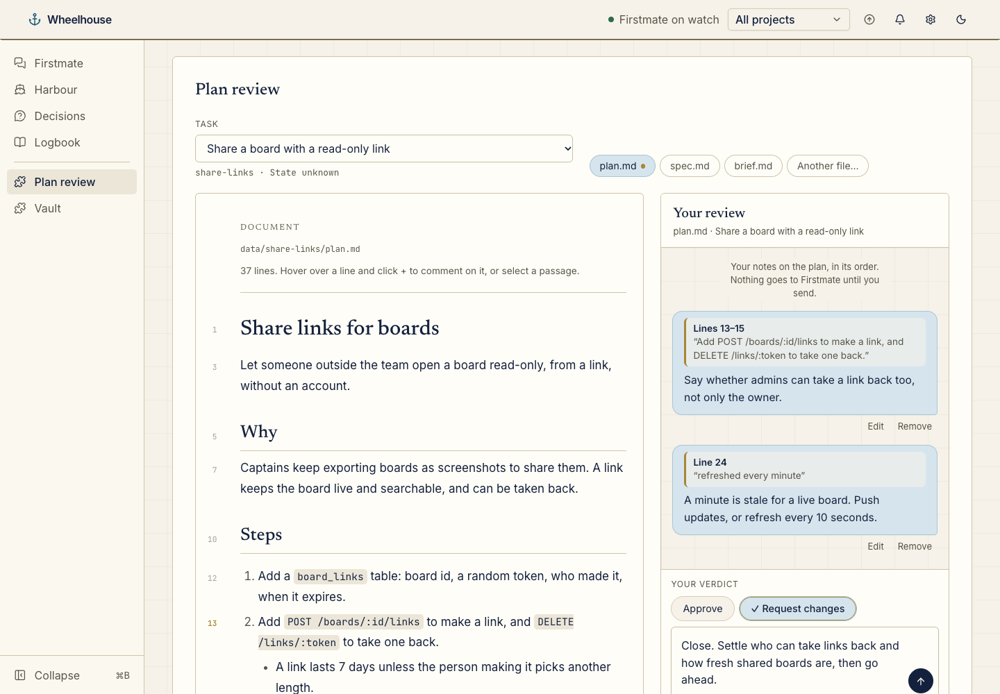
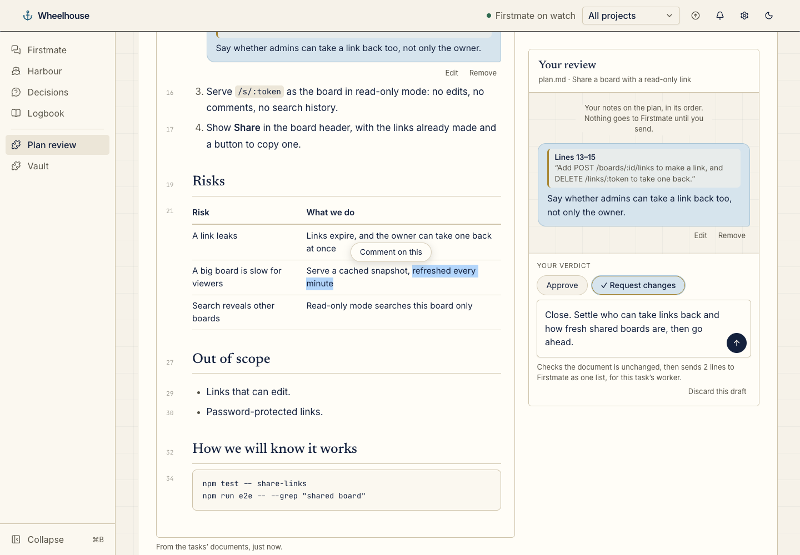
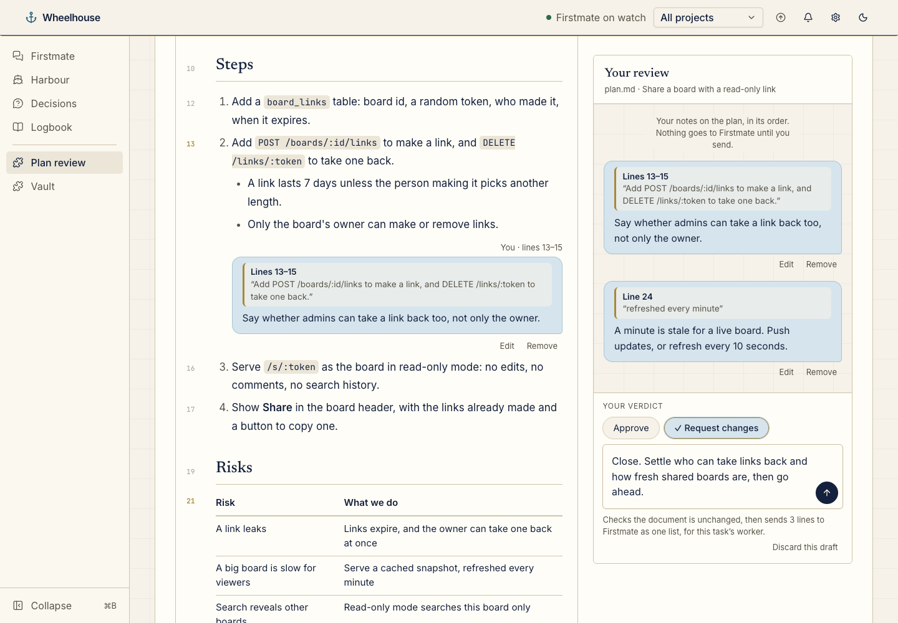
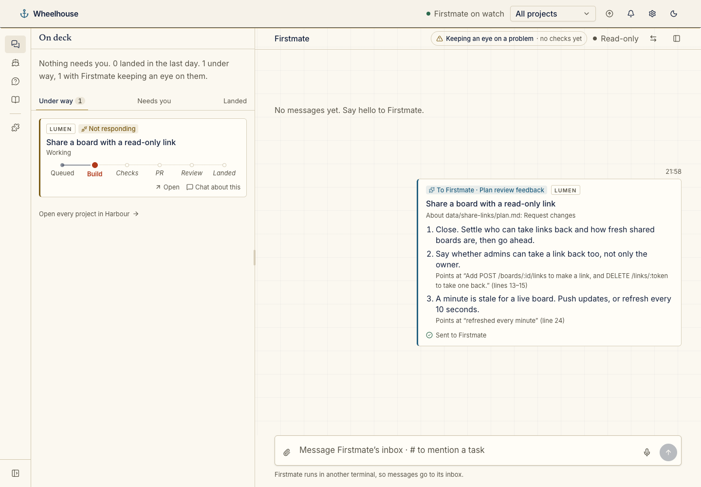

# plan-review-wheelhouse

A [Wheelhouse](https://github.com/chrisjowen/wheelhouse) plugin that adds a **Plan review** page to Wheelhouse's menu. Pick a task's plan, read it as Wheelhouse's document reader draws it, and comment on a line or a passage. Your notes collect beside the plan as a chat thread. Then approve the plan or ask for changes, and send everything to Firstmate as one list. Firstmate passes it to the task's worker, the same way a list from a task's Preview tab goes.



It is Wheelhouse's own way to review a plan, built on Firstmate's flow rather than beside it: nothing runs its own agent loop or keeps its own approval record. Your notes and your verdict go to Firstmate's inbox as one message about the task, and Firstmate decides what happens next.

## Install

```sh
wheelhouse plugin install chrisjowen/plan-review-wheelhouse
```

Or use **Settings → Plugins → Install plugin** with `chrisjowen/plan-review-wheelhouse`. Before anything is installed, Wheelhouse shows that the plugin **sends Firstmate feedback lists about a task, each when you click to send it**; that is the only thing it sends. It is off until you turn it on in **Settings → Plugins → Plan review**.

Sending needs a Wheelhouse with the plugin `feedback` capability ([chrisjowen/wheelhouse#98](https://github.com/chrisjowen/wheelhouse/pull/98)). On an older Wheelhouse, the send button stays off and the page says Wheelhouse needs updating.

## Using it

Open **Plan review** in the menu on the left, after the Logbook. It is a page of its own, not part of a task's page: just the plan and your review.

**The task and its documents.** Pick the task at the top. Tasks waiting on you (a decision or a review) come first, marked **waiting on you**. Beside it are the task's Markdown documents in Firstmate's home, `data/<task>/plan.md`, `spec.md` and `report.md` first, then any other `.md` there (Firstmate's briefs last), and any Markdown file the task changed in its worktree. **Another file…** opens any Markdown (`.md`) file by path: one relative to the Firstmate home, such as `data/<task>/plan.md`, or a full path inside a live task's project or worktree. The page remembers it for that task. Every document is read whole through Wheelhouse's own document reader, so it keeps to the same folders, and renders as that reader renders it: GitHub-flavoured Markdown, with nothing in it that can run. The page reads the open document again every 15 seconds and when you come back to the window, so a change on disk shows, and a document it could not read is tried again then and when you pick it. The task you are reviewing stays on the page, as last seen, even if a refresh no longer lists it.

**A link to a task's plan.** `/plugins/plan-review/review?task=<task>&doc=<path>` opens the page on that task and document, for example `?task=share-links&doc=data/share-links/plan.md`. Firstmate can post one in the chat. A link can name a task that has no documents on offer yet, as long as it names its file.

**Commenting.** Each paragraph, heading, list item, table and code block shows its line number. Hover over it and click **+** to write a note about those lines. Or select a passage and click **Comment on this**: the note quotes what you selected, with its lines. You write the note in a chat bubble under the text, with the passage it is about quoted on top, and it stays there as your bubble, with **Edit** and **Remove** under it. **⌘↵** (Ctrl+Enter) saves a note and **Esc** leaves it.



**Your review.** Beside the plan (below it on a narrow page), the review reads like a conversation: each note is your bubble in the order it appears in the plan, quoting its passage. Click the quote to find it in the plan. Under the thread, pick **Approve** or **Request changes**, add a note about the plan as a whole if you like, and press the round send button (or **⌘↵** in the note). Before anything is sent, the page reads the document again through Wheelhouse's document reader, whole, and sends it all as one list only if it is the text you wrote your notes on. If it changed, nothing is sent: the page says so and offers **Use the new text**, which moves your notes onto the new text (see **Drafts**) so you can check them and send again. The same goes for a file opened by path. While a review is sending, your notes and verdict stay as they are until Wheelhouse answers. Approving with nothing to add still sends one line, _Approved as written. Go ahead._, so Firstmate hears your verdict. Requesting changes needs at least one note. On a narrow page a bar at the bottom keeps **Send to Firstmate** in view (or **Finish your review**, which takes you to the verdict). What you sent shows in the thread as your message.



**Drafts.** Your notes, verdict and overall note are kept in this browser per task and document until you send them, so you can leave, switch tasks and come back. A dot on a document's name means it has a draft. **Discard this draft** clears it. If the document changes while you have a draft, the page shows the new text and says so, but your notes stay with the text you wrote them on until you click **Move notes onto this text**: then each note moves to where its quote now is, and a note whose text is gone is marked **text changed**.

### What Firstmate receives

Wheelhouse writes the message, not the plugin, in the same shape as a list from a task's Preview tab, and sends it to Firstmate's inbox as one note about the task (`Re: <task>`):

```
Feedback for share-links (Share a board with a read-only link), sent together from the “Plan review” plugin (plan-review), about data/share-links/plan.md: Request changes:
1. Close. Settle who can take links back and how fresh shared boards are, then go ahead.
2. Say whether admins can take a link back too, not only the owner.
   Points at: “Add POST /boards/:id/links to make a link, and DELETE /links/:token to take one back.” (lines 13–15)
3. A minute is stale for a live board. Push updates, or refresh every 10 seconds.
   Points at: “refreshed every minute” (line 24)

Firstmate: pass these to this task’s worker, the same task (start no new one). You may add notes of your own, marked as yours.
```

The overall note comes first, then each note in the order of the document, with what it quotes and its lines. The chat shows the list as your card, addressed to Firstmate, with whether Firstmate has it and its reply.



A list holds up to 30 lines of up to 500 characters each, Wheelhouse's limits for one feedback list; the page says so before you send if a review goes over.

## What it reads and sends

- **Reads.** The page's provider, run by Wheelhouse on the server for the whole fleet, lists `data/<task>/` in the Firstmate home for each task that is not landed or done (the first 60 of those, waiting on you first, of which up to 40 with something to read are listed, and 8 Markdown files each), and up to 4 Markdown files each live task changed in its worktree. To read those, it runs `git worktree list` once per project to learn each task branch's worktree path. It hands the page paths only. The page reads the document you open, a file you open by path, and the document again on **Send**, through Wheelhouse's document reader (`/api/files`).
- **Sends.** Only when you click send, through Wheelhouse's `feedback` capability, as one list about the task picked at the top. There is no other way for it to message Firstmate. It has no companion service or settings, and the page talks only to Wheelhouse.
- **Keeps.** Drafts, the task last open, the files you opened by path, and what you last sent are kept in this browser's local storage, not in the Firstmate home.

## Development

```sh
npm ci
npm test       # node --test: the provider, the review list, Markdown rendering and the page in jsdom
npm run lint   # ESLint and Prettier
```

- `.wheelhouse-plugin/plugin.json` is the manifest: one `nav.page` contribution and the `feedback` capability.
- `wheelhouse/server/index.js` is the server entry: the fleet `plans` provider.
- `wheelhouse/ui/index.js` is the page, the custom element `plan-review-page`; `doc.js` renders the document into parts that know their lines, `notes.js` turns the review into the feedback list, and `styles.js` lays the page out. The element draws in light DOM, so Wheelhouse's own chat classes (`bubble`, `bubble-captain`, `reply-quote`, `chat-grid`) style the thread exactly as they style Firstmate's chat; everything else uses only Wheelhouse's CSS variables, so the page follows the light and dark themes.
- `wheelhouse/ui/vendor/` holds the Markdown libraries Wheelhouse's own reader uses, at the same versions: marked 16.4.2 (MIT) and DOMPurify 3.4.17 (Apache-2.0 or MPL-2.0), each with its licence header. Wheelhouse loads installed plugins without a build step, so they are copied in as they ship. After changing a version in `package.json`, run `npm install && npm run vendor`; a test checks the copies match.

## Licence

MIT
